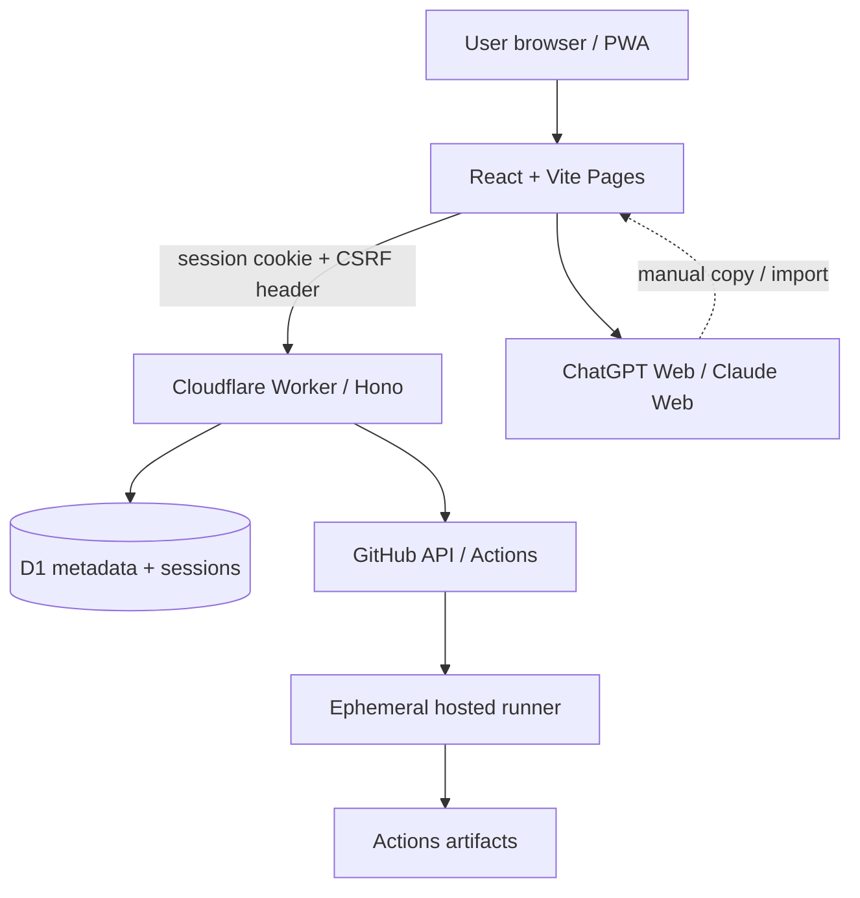

# Architecture

## Product model

BYGA CLI-Anything is a human-controlled engineering workbench with two separate workspaces:

- **AI Workspace:** prepare project context and prompts for ChatGPT Web or Claude Web; the user opens the official service, conducts the conversation, and imports the result. BYGA does not claim to read or control those conversations.
- **GitHub Workspace:** inspect repositories, branches, commits, diffs, pull requests, CI and staged patch application through explicit user actions.

MCP BYGA is optional. Its available tools can help during an interactive BYGA session, but they do not imply a remote HTTP agent-completion endpoint callable from GitHub Actions. Missing MCP/agent capability must not block the core product.

## Runtime

Workers authenticate, validate, orchestrate and persist bounded metadata. GitHub Actions performs explicitly dispatched isolated tasks. No VPS, persistent runner, cron, background AI agent or automatic production deployment is required.

## Data model

Migration `0001_init.sql` is the legacy repository/job/audit foundation. Migration `0002_workspace.sql` adds:

- `users`: operator identity row (`owner`); no credentials.
- `projects`: owner-scoped project and optional allowlisted repository association.
- `project_contexts`: immutable versioned Markdown context with bounded metadata.
- `ai_tasks`: provider/task prompt, manual handoff lifecycle and imported result summary.
- `imported_results`: staged bounded import metadata and review status.
- `artifacts`: metadata for GitHub Actions or optional R2 objects.
- `user_settings`: owner-scoped non-secret preferences.

Migration `0003_password_auth.sql` adds `sessions` (SHA-256 of the session token, expiry, revocation) and `login_attempts` (HMAC-keyed rate-limit counters). It supersedes the Cloudflare Access identity comment in 0002: identity is now the fixed `owner` user created at first successful login.

Secrets and environment variables must never be stored in context, prompts, results, artifacts, or settings.

## Security invariants

- Every `/api/*` route except health and the auth endpoints requires a valid, unexpired, unrevoked session.
- State-changing requests require an exact Origin match and a CSRF token derived from the session.
- `APP_PASSWORD` is a Worker secret only; the password, raw session token and raw client address are never stored.
- GitHub credentials remain Worker secrets; no target write credential is sent to AI or target checkout.
- Repository source and AI output are untrusted data.
- Imports are staged and validated; no direct application to `main`.
- Branch/PR writes and merges require explicit user action and review.
- Generation fails closed until a real adapter is independently verified.
- Production provisioning/deployment is a separate approval gate.
