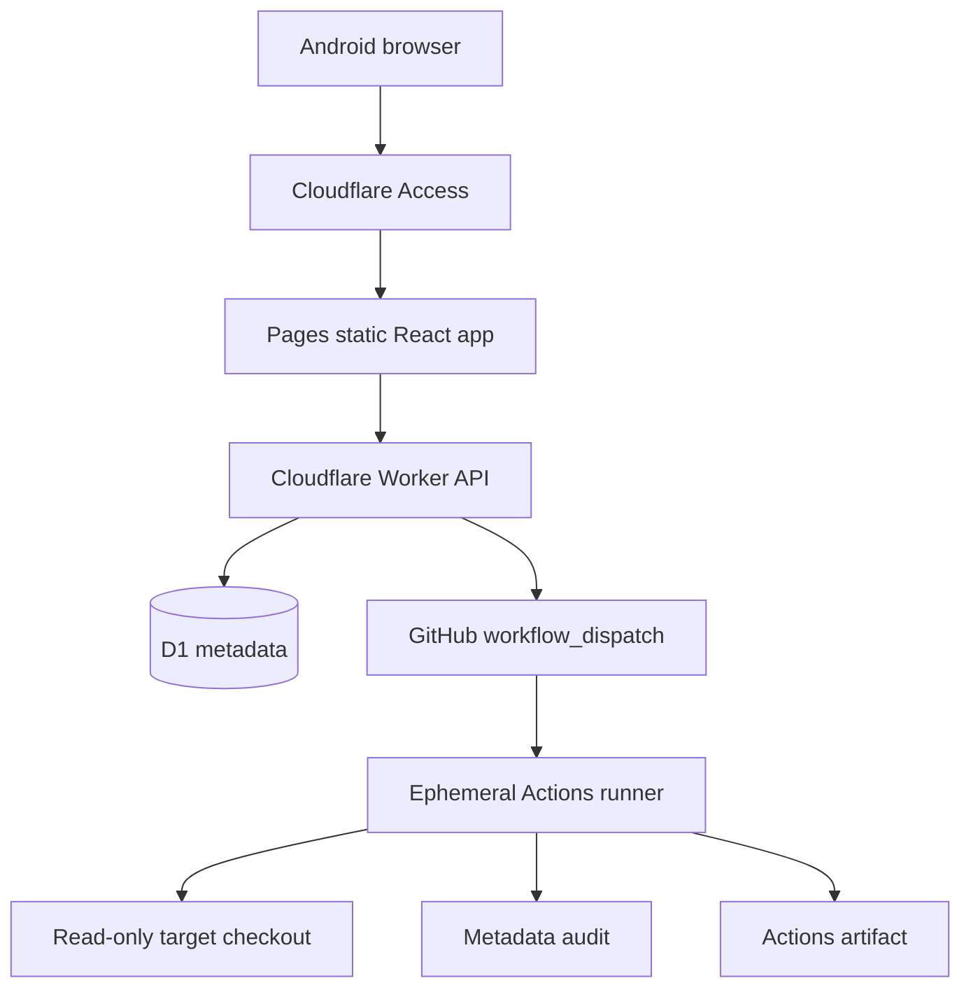

# Architecture

Workers authenticate, validate, orchestrate and persist metadata only. GitHub Actions runs Python. No R2 duplication in MVP; Actions artifacts retained 7 days. Agent adapter is a separate optional HTTP contract; MCP tools are not presumed callable from a runner.
